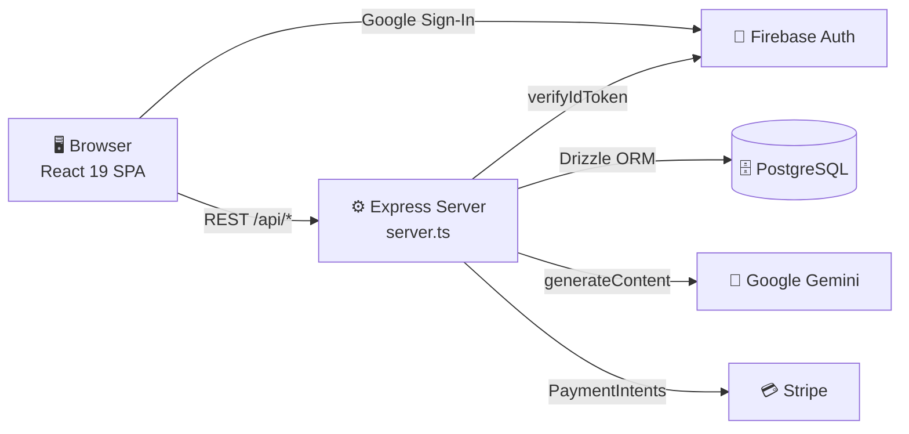
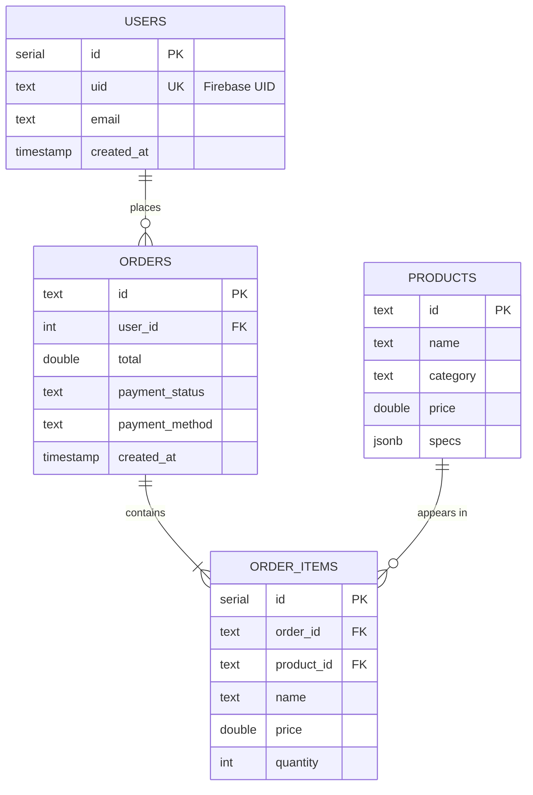

<div align="center">

# 🛒 InnovateCart

### AI-Powered E-Commerce Platform

A minimalist, full-stack online store for premium creative and developer hardware, with a **Gemini-powered support concierge** and an **AI product recommender** that understands plain-English requests.


<br/>


</div>

---

## ✨ Features

**🤖 AI Setup Configurator.** Describe what you need in your own words (*"minimalist coding desk"*, *"high-fidelity audio setup"*). Gemini analyses your request together with your current cart, picks the best product from the catalog, and explains why in one or two sentences. The response is requested as strict JSON and parsed on the server.

**💬 AI Support Concierge.** A floating chat assistant that answers questions about products, specs, shipping, warranty and payments. Each request includes the live product catalog and the user's cart as context, and the full conversation history is sent so it can handle multi-turn chats.

**🛍️ Storefront.**
- A featured product view that shows specs and price.
- A catalog grid with category filters and live search from the navbar.
- A slide-out shopping bag with quantity controls.
- Smooth page and drawer animations built with Motion.

**💳 Checkout.**
- An order summary showing an 8% estimated tax and free express shipping on orders over $500.
- Server-side **Stripe PaymentIntent** creation.
- An order confirmation screen.

**🔐 Authentication & Order History.**
- **Google Sign-In** with Firebase Auth.
- Every protected request is verified on the server with `firebase-admin`.
- Signed-in users are synced to PostgreSQL and can view their past orders.

**🗄️ Relational Data Layer.** A PostgreSQL schema managed with **Drizzle ORM**. Each order and all its items are written in a single **database transaction**.

**🛟 Graceful Fallbacks (Demo Mode).** The app runs with zero configuration:
- Without a database, it uses an in-memory catalog and in-memory order storage.
- Without a Gemini key, the chatbot gives keyword-based replies.
- Without a Stripe key, payments use a simulated sandbox.

---

## 🏗️ Architecture

A single Express server exposes the REST API and serves the React SPA. In development, Vite runs as Express middleware; in production, the server serves the pre-built `dist` folder.



### Database Schema



---

## 🧰 Tech Stack

| Layer | Technologies |
|---|---|
| **Frontend** | React 19, TypeScript, Tailwind CSS v4, Motion, Lucide Icons |
| **Backend** | Node.js, Express 4, tsx |
| **AI** | Google Gemini via `@google/genai` |
| **Database** | PostgreSQL, Drizzle ORM, drizzle-kit, `pg` |
| **Auth** | Firebase Authentication (Google provider), Firebase Admin SDK |
| **Payments** | Stripe (PaymentIntents API) |
| **Build** | Vite 6, esbuild |

---

## 🚀 Getting Started

### Prerequisites

- **Node.js 18+** and npm
- *(Optional)* a PostgreSQL database
- *(Optional)* API keys for [Google Gemini](https://aistudio.google.com/apikey) and [Stripe](https://dashboard.stripe.com/test/apikeys) (use a **test** key)
- *(Optional)* your own [Firebase](https://console.firebase.google.com/) project with Google Sign-In enabled

### 1. Clone and install

```bash
git clone https://github.com/NusratZahanSadia/InnovateCart.git
cd InnovateCart
npm install
```

### 2. Configure environment variables

Copy the example file and fill in what you have. Every key is optional; anything you leave out falls back to demo mode.

```bash
cp .env.example .env
```

| Variable | Description |
|---|---|
| `GEMINI_API_KEY` | Enables the real AI chatbot and recommendations |
| `STRIPE_SECRET_KEY` | Enables real Stripe PaymentIntents (use `sk_test_...`) |
| `NEXT_DISABLE_DB` | `"true"` uses the in-memory catalog; `"false"` uses PostgreSQL |
| `SQL_HOST`, `SQL_DB_NAME` | PostgreSQL host and database name |
| `SQL_USER`, `SQL_PASSWORD` | Credentials used by the app at runtime |
| `SQL_ADMIN_USER`, `SQL_ADMIN_PASSWORD` | Credentials used by drizzle-kit for migrations |

To use your own Firebase project, replace the values in `firebase-applet-config.json` with your project's web app config.

### 3. *(Optional)* Set up the database

With `NEXT_DISABLE_DB="false"` and the SQL variables set, push the schema:

```bash
npx drizzle-kit push --config=src/db/drizzle.config.ts
```

### 4. Run

```bash
npm run dev
```

Open **http://localhost:3000** 🎉

### Production build

```bash
npm run build   # builds the SPA with Vite and bundles the server with esbuild
npm start       # runs dist/server.cjs
```

---

## 📡 API Reference

| Method | Endpoint | Auth | Description |
|---|---|---|---|
| `GET` | `/api/products` | — | Returns the product catalog |
| `POST` | `/api/recommendations` | — | AI pick from `{ userPreferences, currentCartIds }` → `{ productId, reason }` |
| `POST` | `/api/chatbot` | — | AI support reply from `{ messages, currentCart }` |
| `POST` | `/api/create-payment-intent` | — | Creates a Stripe PaymentIntent for `{ amount }` |
| `POST` | `/api/place-order` | Optional | Saves an order and its items in a transaction |
| `GET` | `/api/orders` | Optional | Order history for the signed-in user |
| `POST` | `/api/register-user` | Required | Syncs the Firebase user into PostgreSQL |

Authenticated requests send the Firebase ID token as `Authorization: Bearer <token>`.

---

## 📁 Project Structure

```
InnovateCart/
├── server.ts                   # Express server: REST API, Gemini, Stripe, Vite integration
├── index.html                  # SPA entry
├── vite.config.ts
├── firebase-applet-config.json # Firebase web config
├── src/
│   ├── App.tsx                 # Layout, cart, auth state, AI configurator, drawers
│   ├── main.tsx
│   ├── types.ts                # Shared TypeScript types
│   ├── index.css               # Tailwind + custom styles
│   ├── components/
│   │   ├── ProductSection.tsx  # Catalog grid, filters, search
│   │   ├── CheckoutModal.tsx   # Order summary & payment form
│   │   ├── Chatbot.tsx         # AI support concierge widget
│   │   ├── AboutSection.tsx
│   │   └── ContactSection.tsx
│   ├── db/
│   │   ├── schema.ts           # Drizzle schema & relations
│   │   ├── index.ts            # PostgreSQL pool + Drizzle client
│   │   ├── users.ts            # User upsert helper
│   │   ├── sync.ts             # Product seeding / sync hooks
│   │   └── drizzle.config.ts
│   ├── lib/
│   │   ├── firebase.ts         # Client SDK (Google provider)
│   │   └── firebase-admin.ts   # Admin SDK (token verification)
│   └── middleware/
│       └── auth.ts             # requireAuth middleware
└── package.json
```

---

## 🗺️ Roadmap

- [ ] Confirm card payments on the client with **Stripe Elements** and track status with webhooks
- [ ] Recalculate order totals from database prices on the server
- [ ] Connect the contact form to a real backend
- [ ] Seed the product catalog into PostgreSQL from a single source of truth

---

## 👩‍💻 Author

**Nusrat Zahan Sadia**

[](https://github.com/NusratZahanSadia)
[](https://www.linkedin.com/in/nusrat-zahan-18b028413)
[](mailto:nusratzahan6070@gmail.com)

<div align="center">

⭐ If you like this project, consider giving it a star!

</div>
